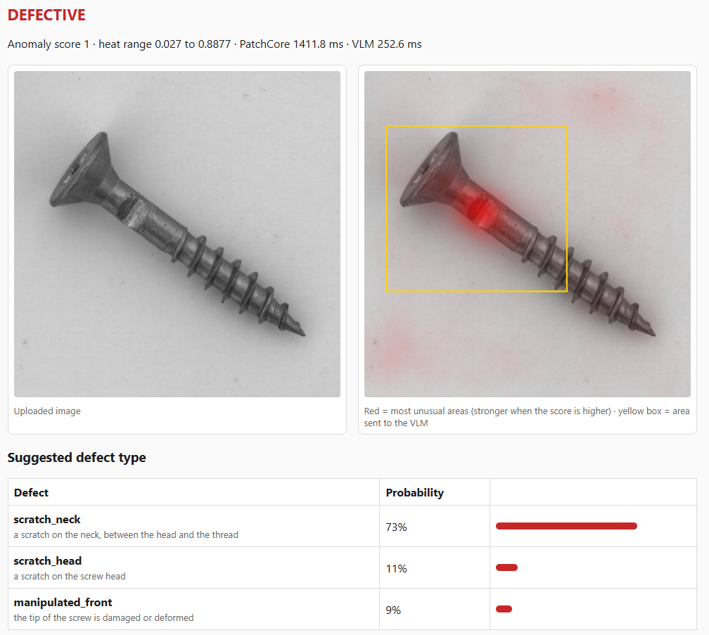

# defect-inspector

**Industrial visual inspection that combines a classic anomaly detector with a small vision-language model — and measures honestly where each one works.**

PatchCore decides whether a part is defective and *where*; a zero-shot Qwen3.5-2B vision-language model (VLM) then suggests *what* the defect is. Everything runs locally on a 6 GB laptop GPU, and every number below comes from the scripts and CSV files in this repository.



---

## Headline results

Evaluated on four industrial categories of [MVTec AD](https://www.mvtec.com/company/research/datasets/mvtec-ad) (screw, metal nut, cable, transistor).

| Task | Method | Result |
|---|---|---|
| Detect defective parts | PatchCore (defect-free training images only) | **98.8% mean image AUROC**, 98.4% pixel AUROC |
| Detect defective parts | Qwen3.5-2B, zero-shot, no training | **83.5% mean image AUROC** (93.9% on screw, statistically tied with PatchCore) |
| Name the defect type | Hybrid: PatchCore crop + calibrated VLM | **46.8% accuracy** vs 27.9% for the VLM alone (random guessing ≈ 20%) |

---

## How it works

```
image ──► PatchCore ──► good / defective + anomaly heatmap
                              │
                              ▼ (defective only)
                      box around the hottest area
                              │
                              ▼
                      close-up crop ──► Qwen3.5-2B multiple-choice question
                                         ("Which defect is it? A. … B. …")
                                                    │
                                                    ▼
                                    bias calibration (blank images)
                                                    │
                                                    ▼
                                    top-3 defect suggestions + probabilities
```

**PatchCore** passes the defect-free training images once through an ImageNet-pretrained WideResNet-50 and stores their patch features in a memory bank (10% coreset). At test time, patches far from every stored normal patch are flagged. No defective image is ever used to build the model — which is how real production lines work, where defects are rare.

**The VLM** is used zero-shot, exactly as downloaded. Instead of reading its text answer, the evaluation reads its internal probability of answering "DEFECTIVE" vs "GOOD" (or each option letter), which gives a continuous score that can be compared with PatchCore using the same metric.

---

## Results in detail

### 1. Detection: PatchCore vs zero-shot VLM (image AUROC)

| Category | PatchCore | Qwen3.5-2B (16-bit) | 95% CI (VLM, bootstrap) | Qwen3.5-4B (4-bit) |
|---|---|---|---|---|
| screw | 0.964 | 0.939 | 0.896 – 0.972 | 0.931 |
| metal_nut | 0.999 | 0.852 | 0.758 – 0.937 | 0.741 |
| cable | 0.991 | 0.802 | 0.731 – 0.869 | 0.787 |
| transistor | 0.996 | 0.745 | 0.622 – 0.846 | 0.773 |
| **Mean** | **0.988** | **0.835** | | **0.808** |

- On **screw**, the hardest category, the VLM's confidence interval contains PatchCore's score: no significant difference, with zero training.
- On the other three categories PatchCore is clearly better.
- The **4B model did not improve** on the 2B (overlapping intervals). Note: this compares 4B at 4-bit with 2B at 16-bit, so model size and compression are not separated.

PatchCore pixel metrics: mean pixel AUROC 0.984, pixel F1 0.616. Pixel F1 is low on screw (0.370) because defects cover ~1% of the image and the heatmap blobs are wider than thin scratches — one reason no single metric is reported alone.

### 2. The VLM detects damage, not wrong arrangement

Image AUROC per defect type (each defect type vs the good images of its category):

| Visible damage | 2B | 4B | Wrong arrangement | 2B | 4B |
|---|---|---|---|---|---|
| transistor `damaged_case` | 0.94 | 0.997 | metal_nut `flip` (upside down) | 0.64 | **0.30** |
| metal_nut `color` | 0.95 | 0.85 | cable `cable_swap` | 0.51 | 0.57 |
| screw `thread_side` | 0.97 | 0.94 | cable `missing_cable` | 0.60 | 0.79 |
| cable `bent_wire` | 0.92 | 0.83 | transistor `misplaced` | **0.43** | 0.53 |

A flipped nut or swapped wires look perfectly normal unless you know what the *correct* part looks like. PatchCore learns that from 200+ good examples; a zero-shot VLM has never seen the product. Scores below 0.5 mean the model rates these defective parts as *more* normal than real good ones.

*(From `reports/vlm_qwen3.5-2b_by_defect.csv` and `reports/vlm_qwen3.5-4b-4bit_by_defect.csv`.)*

### 3. Defect naming: the hybrid and bias calibration

344 truly defective test images; the VLM picks the defect type from a multiple-choice list built from MVTec's folder names.

| View shown to the VLM | Raw | Calibrated |
|---|---|---|
| full image (VLM alone) | 27.9% | 37.2% |
| full image + PatchCore box drawn in red | 35.8% | 41.3% |
| **close-up crop of PatchCore's box** | 33.4% | **46.8%** |

Random guessing ≈ 20% (weighted by category). PatchCore's box touched the real defect on 344/344 images (the boxes are deliberately large — at least 25% of the image plus a margin — so this is a lenient test).

**Answer bias.** Uncalibrated, the VLM has a "default answer" per category — e.g. `poke_insulation` for **92 of 92** cable images, whatever the image showed. **Contextual calibration** ([Zhao et al., 2021](https://arxiv.org/abs/2102.09690)) measures that bias by asking the same question about blank grey, black and white images, then divides it out. No labels or test images are used to measure it.

What calibration revealed (crop view, raw → calibrated):

| Defect | Raw | Calibrated |
|---|---|---|
| metal_nut `scratch` | 4/23 | **21/23** |
| screw `thread_side` | 0/23 | **13/23** |
| metal_nut `flip` | 0/23 | 10/23 |
| metal_nut `bent` (was the default answer) | 25/25 | 9/25 |
| cable `missing_wire` / `poke_insulation` | 0/10 · 10/10 | 10/10 · 0/10 |

Calibration uncovers real skill hidden behind the default answer, and removes "free" points the default was collecting. On **cable** it simply swaps one default for another: calibration cannot create skill that is not there.

### 4. Measurement checks

- **Prompt sensitivity** (screw, 2B): a leading prompt ("Is the screw defective?") made the model answer DEFECTIVE to 160/160 images (AUROC 0.899); a neutral prompt gave 27/160 (AUROC 0.929). Text answers alone swing completely with wording — which is why scores, not text, are evaluated.
- **Score precision**: computing the two answer scores from 16-bit logits produced only 25 distinct values across 525 images (ties). Recomputing them in 32-bit gave one distinct score per image; mean AUROC moved from 0.828 to 0.835 and every conclusion held.
- **Consistency**: the calibration run reproduced the uncalibrated predictions of the previous stage on all 1,032 rows.

---

## Demo app

A FastAPI service with an upload page: choose a part type, upload an image, get the verdict, a heatmap with PatchCore's box, and the top-3 defect suggestions.

Typical latency on an RTX 3060 Laptop GPU: PatchCore ~0.2–0.45 s, VLM ~0.2–0.6 s per image.

---

## Run it yourself

Windows, Python 3.11, NVIDIA GPU with ≥6 GB.

```bat
py -3.11 -m venv .venv
.venv\Scripts\activate.bat
pip install "anomalib[cu126]"
pip uninstall -y torch torchvision
pip install torch torchvision --index-url https://download.pytorch.org/whl/cu126
pip install -U transformers accelerate fastapi uvicorn python-multipart
```

Download MVTec AD from the [official page](https://www.mvtec.com/company/research/datasets/mvtec-ad) (licence CC BY-NC-SA 4.0, non-commercial) and extract the category folders into `datasets/` (e.g. `datasets/screw/train/good`).

| Step | Command | Output |
|---|---|---|
| Explore the data | `python scripts\explore_dataset.py` | counts + mask check |
| PatchCore baseline | `python scripts\patchcore_baseline.py` | `reports/patchcore_baseline.csv` |
| Zero-shot VLM | `python scripts\vlm_zero_shot_all.py` | `reports/vlm_<model>_*.csv` |
| Hybrid, stage A | `python scripts\hybrid_a_patchcore_predict.py` | `reports/hybrid_patchcore_predictions.csv` |
| Hybrid, stage B | `python scripts\hybrid_b_vlm_name_defects.py` | `reports/hybrid_naming_*.csv` |
| Calibrated naming | `python scripts\hybrid_c_calibrated_naming.py` | `reports/hybrid_calibrated_*.csv` |
| Export models | `python scripts\export_models.py` | `models/<category>/…/patchcore.pt` |
| Demo app | `uvicorn app.main:app --port 8000` | http://127.0.0.1:8000 |

The Qwen3.5-2B weights (~4.5 GB) download automatically from Hugging Face on first use. Seeds are fixed (42) so results are repeatable.

```
defect-inspector/
├── scripts/      evaluation scripts, one per step
├── reports/      result tables (CSV) produced by the scripts
├── app/          FastAPI demo (pipeline.py reuses the evaluated code)
├── datasets/     MVTec AD (not in git)
├── models/       exported PatchCore models (not in git)
└── results/      checkpoints and heatmaps (not in git)
```

---

## Limitations

- **Small test sets per defect type** (10–25 images): one mistake moves a per-type accuracy by 4–10 points. Counts are reported next to percentages, and AUROCs carry bootstrap confidence intervals.
- **Four categories only**, all from one benchmark dataset photographed under controlled conditions. Real production images would need re-validation.
- **Naming accuracy of 46.8%** is well above chance but far from production-ready: suggestions are meant for a human inspector to confirm, not to act on automatically.
- **4B vs 2B** mixes model size and 4-bit compression; a 2B-at-4-bit run would separate them.
- **Large boxes** around the anomaly (by design, to keep context) make the "box touches the defect" check lenient.

---

## References

- Roth et al., *Towards Total Recall in Industrial Anomaly Detection* (PatchCore), CVPR 2022.
- Bergmann et al., *MVTec AD — A Comprehensive Real-World Dataset for Unsupervised Anomaly Detection*, CVPR 2019.
- Zhao et al., *Calibrate Before Use: Improving Few-Shot Performance of Language Models*, ICML 2021.
- [anomalib](https://github.com/open-edge-platform/anomalib) (PatchCore implementation) · [Qwen3.5](https://huggingface.co/Qwen/Qwen3.5-2B) (vision-language model).

---

*Built by [Chris Ngoulou Likibi](https://linkedin.com/in/chrislikibi) — MSc Applied Statistics, background in computer vision and automotive connector manufacturing.*
